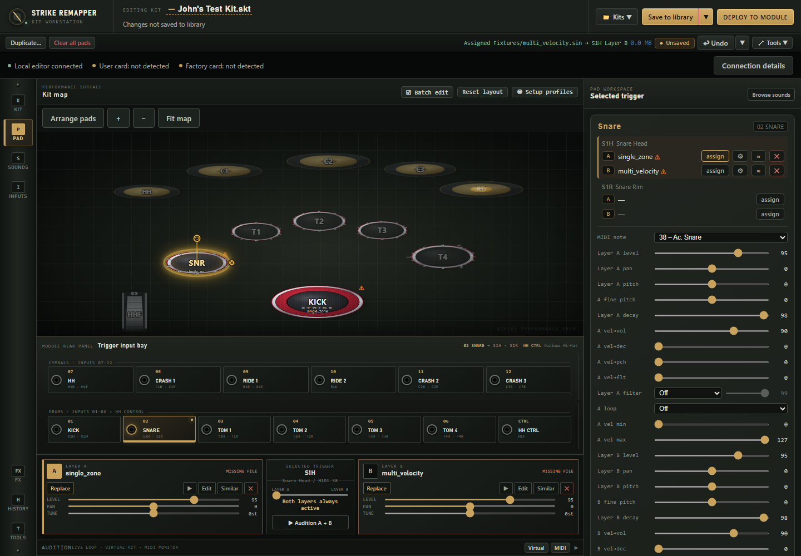

# Strike Pro Remapper


**An offline kit and instrument editor for the Alesis Strike / Strike Pro drum module.**
No module connection required. Windows beta bundles Python, Tk and host MIDI support; the source editor remains standard-library Python.



> Screenshot uses a synthetic test kit; missing-media and card indicators are expected.

The official Strike Editor hasn't been updated since January 2018, requires the module
plugged in via USB for every edit, and never worked reliably on modern macOS. This tool
replaces it: load `.skt` kit files straight from your SD card (or a synced local library),
edit everything in your browser, and write the results back — byte-for-byte lossless for
everything it doesn't touch.

> ⚠️ **Unofficial.** Not affiliated with Alesis or inMusic. The `.skt`/`.sin` formats are
> reverse-engineered. Back up your SD card before writing to it. See
> [Safety](#safety) and [Format status](#format-status) for exactly what is
> hardware-confirmed and how your files are protected.

## Quick start

**Start with the [October 14 tested beta](docs/BETA_CANDIDATE_2026-10-14.md):** exact
Windows/source downloads, checksums, what to open, and a ten-minute first test.
The pinned CI artifacts require GitHub sign-in and expire November 13; they are
controlled beta downloads, not a published stable release.

**Setlist Builder:** open it from Start or the Kits menu to arrange saved library kits
in show order, add song notes, make song-specific kit copies, preview numbered filenames,
and print a show sheet. Keyboard focus stays near the song after removal or cancelling
a kit copy. Lists save on the host and work through the paired Wi-Fi editor.
Export/import human-readable JSON to move a list between libraries. Local checks catch
missing or malformed kits and duplicate planned names; they do not certify samples or
card contents. Batch deployment remains pending. See [the setlist guide](docs/SETLISTS.md).

**Drum MIDI toolkit:** open it from the Start screen or Tools to record a generic
MIDI input, save/import sessions, inspect velocity distributions, compare takes and
export JSON, CSV or a report. Visual replay sends nothing to your module. Includes a
synthetic demo; no Strike kit is needed. Disconnected browser captures retain received
events and a partial-take label through save/export; a normally stopped take stays
complete if the device disconnects later. Sessions stay in this browser, with explicit
Save and portable JSON export. **Save as new copy** preserves an earlier take; stale
tabs cannot silently overwrite or delete a newer saved session. Capture directly with Web MIDI, or use **Wi-Fi host
computer** from a paired iPad/iPhone: the USB host records and timestamps the take,
and the browser receives it live. Host capture needs the optional MIDI input package;
see [setup, recovery and limits](docs/MIDI_TOOLKIT.md).
**Host setup check** reports missing MIDI support, driver errors and visible inputs.
The launcher demo retains host MIDI access after Wi-Fi pairing; the host accepts
parallel toolkit asset loads over the LAN.
Editor startup uses the bound address directly, so an unavailable reverse-DNS
resolver cannot stall starting the offline host.
[Mac + Strike acceptance](docs/MAC_HARDWARE_ACCEPTANCE_2026-10-14.md) verifies live
CoreMIDI capture, idle capture lease/ownership/reopen behavior, and factory/user-card
discovery; Windows hardware acceptance remains open.
For the remaining device checks, use the [prepared acceptance sessions](docs/HANDS_ON_ACCEPTANCE.md).
**Pad names & MIDI Learn** lets you build named profiles for any module, confirm each
learned channel/note, and export/import profiles between devices. Saved sessions keep
their own pad names; MIDI messages and module settings stay unchanged.
Profile confirmations catch saved-content changes made in another tab while you decide.
Add searchable notes/tags, back up groups of saved sessions, focus analysis on one
pad/channel and follow optional repeatable capture exercises. JSON/CSV keep every
event; focused reports describe only the selected channel/note.

**Windows without installing Python:** use the Windows x64 beta ZIP from a tested
build. Its **Help** folder includes detailed guides readable in Notepad, including
Wi-Fi pairing, MIDI sessions, recovery and upgrades. Download from a successful
[CI run](https://github.com/Coober666/strike-pro-remapper/actions/workflows/ci.yml)
(artifact named `strike-windows-beta-…`; GitHub sign-in required). Extract the
artifact and then the application ZIP fully. Open **Strike Remapper.exe**, then
**Open editor** or **Try a demo**. See the [Windows walkthrough](docs/WINDOWS_BETA.md).
This is an unsigned beta, not a published signed installer. Updates are manual.

**Testing a source beta ZIP?** Follow the [first-run walkthrough](docs/BETA_START.md).
The portable package keeps application files separate from your library and includes
a file-hash manifest. Python is still required; it is not a signed installer.

Requirements: **Python 3.10+**. The application uses only the standard library, so there is
nothing to `pip install`.

```
git clone https://github.com/Coober666/strike-pro-remapper
cd strike-pro-remapper
python3 strike_remap.py       # macOS / Linux   — opens http://localhost:8765
py strike_remap.py            # Windows
```

(The command differs per OS on purpose: stock macOS has no `python`, and on Windows
`python3` can silently resolve to a different Microsoft Store interpreter — `py` is the
reliable launcher there.)

Or double-click `launch.bat` (Windows) / `launch.command` (macOS).

**Optional host window:** double-click `launch-host.bat` / `launch-host.command`, or run
`python launch_editor.py` (`python3` on macOS). This requires Python 3.10+ with Tk.
Launcher actions stay visible in two rows at the minimum window size, including
**Retry recovery save** when a final recovery write fails.
Choose your existing library folder, then **Start** and **Open editor**. The folder is
remembered across launches. Choose a persistent folder separate from the application;
the host rejects the source application's root, including a fresh extraction.
For iPad/iPhone, enable Wi-Fi, select this computer's private IPv4 address, start,
and scan the pairing QR code. The code is generated locally. **Stop** saves a recovery
copy of unsaved kit edits before shutting down this host. If the final recovery write
fails, keep the window open and use **Retry recovery save** after fixing the folder or
disk-space problem. Host controls stay visible in shorter windows; setup and pairing scroll.
Existing command-line
launchers remain available; see [host setup and upgrades](docs/HOST_LAUNCHER.md).

The host window explains missing Tk, unavailable Wi-Fi addresses and occupied ports,
and catches common wrong-library selections. See [first-run help](docs/HOST_LAUNCHER.md#first-run-help).
Wi-Fi pages pause editing after a connection loss or suspended tab and reload host state
before resuming. A lost Save response remains unconfirmed and is never automatically retried.

> **First-run notes:**
> - **macOS:** expect a one-time "access files in your Documents folder" / removable-volume
>   permission prompt — the app needs it to read the SD card and your library. If
>   `launch.command` opens a Terminal that errors immediately mid-path, an oh-my-zsh
>   update prompt swallowed the command — run it again (or update oh-my-zsh first).
> - **Windows:** if you downloaded the repo as a ZIP, SmartScreen may warn on `launch.bat`
>   ("Windows protected your PC") — choose *More info → Run anyway*. A `git clone` won't
>   trigger this.

**The start screen.** The app opens on a start screen instead of an empty editor: it shows
what it can see (local library, user card, factory card), kits you have actually opened, and four ways in
— open a kit (`O`), confirm and copy your library from the module (`S`), import content (`I`), or create
a new kit (`N`). If a previous session left unsaved work, recovery is offered there first.
Click the **Strike Remapper** logo any time to come back to it; `Esc` returns to your kit.
Nothing on this screen writes to the module. A brief signal-path check covers the empty editor
while the workspace loads; if that check fails, you can retry it or continue into the editor.

**With your SD card:** insert it and the app finds your kits and instruments automatically
(detected by their content — the factory preset card by its `Kits/<CATEGORY>/` tree, the
user card by being writable; volume names don't matter — or one folder level deep for
Ventoy-style setups).
Use **Sync full library from SD** to copy everything into `library/` so you can edit with
no SD card present — e.g. on a laptop away from your kit.

**Without an SD card:** the app runs entirely against a local `library/` folder
(`kits/`, `instruments/`, `samples/`).

Saving keeps a working copy in the local library. When you are ready, **Deploy to Module**
runs a preflight, shows the exact kit/assets and destination, backs up a replaced kit,
copies to the writable Strike SD card, and verifies the result. Put the card back in the
module and load the kit. (Live USB sync to the module is not supported — that protocol
is still unmapped. See `RESEARCH.md`.)

**"The SD card stopped responding for a moment".** The module keeps its card mounted internally
while also sharing it over USB, and under heavy use the card goes unresponsive for a few
seconds. It stays plugged in and nothing is damaged — Windows may make it look like the drive
vanished, but it did not. The app waits these out automatically, so you will usually never see
this; if the message does appear, give it a few seconds and try again. If it keeps happening,
leave the official Strike Editor open while you work — the module appears to hold on to the
card when the editor is closed.

**"Could not be verified" in preflight.** The module's factory card needs an activation
message before the computer can access it. Use **Activate factory card** in Start,
Tools, or Deploy to send it from this app. When the card is unavailable,
factory sounds your kit uses are reported as a warning, never as an error —
the module resolves them itself, so deploying is still safe. To silence the warning, open
the activation dialog and wait for the card to be detected, then press **Capture factory card**
in the Deploy dialog; the inventory is saved to `library/preset_manifest.json` and reused
from then on. If a sound really is gone, **Fix broken paths** is the tool for that.

**Activate the factory card without the official editor.** Plug the Strike into the
computer running both this app and its browser. Open `http://localhost:8765` in Chrome
or Edge, choose **Activate factory card**, allow MIDI access with SysEx, select the Strike,
and press **Activate factory card**. The app sends the verified message once and checks
for the card for up to 15 seconds. It does not activate on startup or retry automatically.
Copying the library and capturing its inventory remain separate actions.

The packet is hardware-confirmed on one Strike connected to an Intel Mac running Monterey,
including after a module power cycle. The browser flow has automated tests with simulated
MIDI and cards; Windows and Linux hardware validation is still needed. Remote browsers,
iPad direct USB, and the read-only web viewer are not supported by this local flow. See the
[protocol findings and evidence](docs/FACTORY_SD_ACTIVATION.md). Live parameter sync and
deactivation remain unmapped.

**Full editor on iPad over Wi-Fi:** leave the Strike connected to your computer and run
`python3 -m strike_remapper.wifi_editor --bind <computer-LAN-IP> --library-root <library-folder>`
with Python 3.10+. Open the printed private pairing link on your iPad, on the same trusted
Wi-Fi network. Use **HTTP**, including in Brave. Open kits, edit pads and instruments,
audition sounds, and save to the computer's library. Deploy remains an explicit action.
**Activate factory card** uses the computer's MIDI connection in this mode.
**Hardware verified October 12, 2026:** an iPad user changed SEVENzREC's snare sound,
saved it to an Intel MacBook's library, deployed it to the Strike's user card, and
confirmed the changed sound on the module. The deployed kit matched the saved library
copy byte-for-byte. See the [verification record and Mac card-recovery notes](docs/WIFI_EDITOR.md#hardware-verification-october-12-2026).
See [full-editor setup and limitations](docs/WIFI_EDITOR.md). The separate
[activation-only controller](docs/IPAD_FACTORY_CONTROLLER.md) remains available.
The native app for a USB cable connected directly to an iPad is paused.

**Kits that came from another Strike library.** Commercial and hand-me-down kits often
reference sounds by names your card does not use, so matching on filename finds nothing.
**Fix broken paths** now falls back to what the pad itself tells it: it ranks replacements by
how closely they match the *working* layer on the same pad, and failing that offers the right
family of instrument. Every row says which it is — a filename match, a sound match, or just
the same family — and you can preview each candidate before choosing. Only filename matches
are pre-selected; suggestions are left unselected on purpose, so nothing is replaced until
you have listened to it.

**Just want to look, not install anything?** Grab the read-only
[Web Viewer](#web-viewer-read-only-zero-install) — a single HTML file that runs from a
double-click.

## How it compares to the official Strike Editor

| | Official Strike Editor | Strike Pro Remapper |
|---|---|---|
| Works without the module connected | ❌ USB connection required for every edit | ✅ fully offline against SD card or local library |
| Platform | Windows/macOS desktop app, last updated Jan 2018, unreliable on modern macOS | Anything that runs Python 3.10+ and a browser |
| Startup | Multi-pass SD scan on every launch (notoriously slow) | Loads instantly; full-library sync is one click, in the background |
| Undo | None | 20-step labeled undo **plus** a persistent kit time machine (snapshot, diff, restore) |
| Velocity editing | Numeric 0–99 knobs | Visual velocity-zone lane and draggable response curves |
| Copy / batch operations | None — set three toms one at a time | Copy/swap pads, batch edit, batch assign from CSV |
| Broken sample paths | "Path not found," no remedy | Relink wizard with exact + fuzzy matching |
| Kit sharing | Bare files with absolute paths that break on other machines | Self-contained bundles (kit + instruments + samples); also imports official-editor and commercial pack zips |
| Finding sounds | Scroll the folder list | Search, tags, favorites, waveform thumbnails, audition at any velocity, **audio similarity search** |
| Hear your kit while editing | Only by writing to SD and reloading the module | **Virtual module**: audition the kit from the real pads (or keyboard) via Web MIDI + Web Audio — single hits and slow grooves, not a low-latency playable instrument |
| Trigger settings backup | Not possible in any official tool | SysEx capture/save/restore over Web MIDI |
| Format documentation | Closed | Open spec in [FORMAT.md](FORMAT.md), round-trip tested |

## Features

**Setlist companion** — the [native iPhone/iPad app](native/StrikeCompanioniOS/README.md)
imports Setlist Builder JSON for song navigation, performance/show notes, search,
adjustable reading sizes, and phone/tablet layouts. It shares the Mac companion’s
Swift library and version-1 format. A local copy restores the setlist, selected song,
reading size and performance view after relaunch. Setlists remain read-only.
The native kit editor opens `.skt` files for confirmed pad settings and Layer A/B
assignments to references already in the kit, with undo/redo and side-by-side details
on wide iPads. A **Drum map** view selects pads in a standard arrangement; zone
buttons switch head/rim and cymbal zones, with the complete Zones list available.
Numeric settings offer a large text-entry field with Clear, a slider
for larger changes, and ±1 buttons for fine adjustment. Tapping the number selects
it for replacement; Apply confirms the edit and Cancel discards it.
**Export new copy** creates a uniquely named kit in a chosen Files
folder, verifies its bytes and never replaces an existing file. Imported originals
stay untouched. Kit edits remain in memory until export; export before closing the
app. Sound availability is not checked; sound libraries, playback and deployment
remain future work.
[Attended iPhone checks](docs/IOS_COMPANION_04_IPHONE_ACCEPTANCE_2026-10-18.md)
confirmed demo song/reading-size restoration, synthetic kit inspection and external
kit Open In/rejection retention. [Initial attended iPad checks](docs/IOS_COMPANION_05_IPAD_ACCEPTANCE_2026-10-18.md)
confirmed demo navigation, both layers, Level editing and Undo. A subsequent
[physical iPad/NAS check](docs/IOS_COMPANION_051_IPAD_NAS_ACCEPTANCE_2026-10-18.md)
verified direct numeric replacement, Undo/Redo and real-kit NAS export/reopen with
an unchanged original and exactly one intended byte changed. Accessibility, MIDI
and module playback remain separate checks.
The [0.5 simulator record](docs/IOS_COMPANION_05_SIMULATOR_ACCEPTANCE_2026-10-18.md)
covers kit-copy editing, original-file preservation and local Files export/reopen.
Native parity CI also runs when the Python editor or binary format implementation changes.
Files cancellation UI regressions query the running Files service's real Cancel
button before the host fallback, requiring valid visible hit targets. A restored
folder uses the real Recents tab rather than the sorting menu; retained-edit and
resumed-editor assertions remain required.
Replacement checks wait for the confirmation alert and require dismissal before inspecting the new kit.
Export-folder provider errors use export-specific destination guidance and clear stale
success messages while retaining edits and Undo history; cancellation stays quiet.

The native iPhone/iPad product is evolving into **Strike Remapper**, one app with
performance and editing views. The existing full web editor is the feature target;
the current Companion-named build is an incremental native implementation and does
not yet have feature parity. The Mac setlist companion remains separate.

The [0.5.1 numeric-input follow-up](docs/IOS_COMPANION_051_SIMULATOR_FOLLOWUP_2026-10-18.md)
records passing editing/export checks on both sizes, the full iPhone result and
the iPad search timeout with its focused follow-up.
The [drum-map prototype check](docs/NATIVE_EDITOR_MAP_SIMULATOR_FOLLOWUP_2026-10-18.md)
records focused selection and zone-switching passes on both simulator sizes.

**Kit editing**
- Visual drum map — realistic top-down kit (red-sparkle shells, mesh heads, chrome
  hoops/lugs, brass cymbals, hi-hat pedal); click a pad, assign instruments to Layer A/B,
  set the velocity crossfade by dragging; pads are draggable/relabelable, snare rim and
  ride bell register on and move with their parent, and any zone can show a **mirror pad**
  for Y-splitter / doubled-trigger setups (same zone, drawn twice)
- **Mock up your exact kit** — every pad is fully editable: drag to position, on-map gold
  handles to resize and rotate (Shift = snap to 15°), size/rotation sliders + a shell-finish
  / cymbal-tone picker in the pad panel (red sparkle, black, white, silver, blue, emerald,
  purple, amber, natural wood; brass / bronze / brilliant / black cymbals). Rims and bells
  inherit their parent's size, rotation, and finish. **Setup profiles** keep multiple
  physical arrangements separate from kit sounds, automatically save edits to the active
  profile, and include **Export active JSON** / **Import setup JSON** for moving a setup
  between Windows and macOS
- Per-layer level, pan, pitch (±12 st), fine pitch (±50 cents), decay, filter
  cutoff/enable; mute groups; MIDI notes; gate time (Free in ms, tempo-synced, or off)
- Copy, swap, and batch-edit pads; batch-assign from CSV; kit diff/compare; rename,
  duplicate, clear; 20-step undo with labeled history; autosave + crash recovery
- CSV assignment validates every row before edits: unknown pads or invalid layers
  reject the batch; missing library instruments are reported and skipped. Valid
  changes share one Undo step; unchanged assignments do not consume Undo history.
- **Kit time machine** — a persistent version history that outlives reloads and restarts
  (the durable counterpart to in-memory undo). Snapshots are captured automatically on
  load and save, on a debounced timer while you edit, and on demand with **Snapshot now**;
  identical states are deduped and old ones age out (pin the keepers). Open the timeline
  (Kits menu → **Kit time machine…**), scrub through the history, **visually diff any two
  points** (or a point vs. your current edit), and **restore** one with a single click —
  and the restore is itself undoable, so you can never lose your place
- Kit size meter (200 MB module limit), broken-sample-path detection, export MIDI map
  as a printable cheat sheet

**Instrument (.sin) editing** — *things the official editor can also do, now offline*
- Full instrument parameters: group, level, pan, decay, semitone + fine pitch, filter
  type/cutoff, velocity→level/decay/pitch/filter response, loop flag
- **Visual velocity-zone editor** — sample mappings drawn as draggable bars on a velocity
  lane (round-robins stacked); drag a split point to retune zone boundaries, click any
  zone to audition its sample at that exact velocity; split zones, add round-robin
  variants, and delete zones from the mapping table
- **Velocity response curves** — drag the curve to set vel→Level/Decay/Pitch/Filter depth
  instead of decoding what "-43" means
- Velocity-layer mapping table with round-robin indices and hi-hat pedal-position ranges
- Round-robin vs. random cycle mode (anti-machine-gun)
- Import WAVs into new multi-velocity instruments, with optional peak normalization and
  **auto-map by loudness** (sorts samples quiet→loud and assigns velocity bands for you)
- Edits write to your local library only; factory presets stay read-only; one-click revert

**Sharing & repair**
- **Kit bundles** — export the current kit, including unsaved edits, plus available
  instruments and samples in a `.zip`. Missing assets are listed in the manifest and
  reported beside the download; an incomplete bundle is not a complete backup.
  Export uses a consistent editor state and prefers edited library instruments.
  Download errors keep the editor open for retry. Import contained assets into another local
  library, then review missing dependencies and conflicts before deployment. Existing
  library files are never overwritten. Supported assets are validated and staged before
  copying; corrupt archives and unsafe paths fail before import. A later disk failure
  reports completed files and recovery steps. See [bundle import recovery](docs/BETA_START.md#importing-a-kit-bundle).
- **Kit JSON report** — export saved library kit assignments and selected pad parameters.
  Unreadable or malformed files appear in `warnings`; autosaves and unsaved edits are
  excluded. This is a report, not an importable kit backup.
- **Official editor & commercial pack zips** — the importer also accepts official
  Strike Editor kit/instrument exports and commercial pack zips (eDrumWorkshop,
  drum-tec, …): any zip carrying `Kits/`/`Instruments/`/`Samples/` folders (even nested
  inside a pack folder) or loose `.skt`/`.sin`/`.wav` files maps straight into the
  library, with loose WAVs placed where the imported instruments expect them.
- **Relink wizard** — when sample paths do break (renamed folders, different machine),
  it finds the missing instruments, suggests matches from your library (exact name first,
  fuzzy match second), and fixes every affected pad in one undoable step.

**Kit FX editor**
- Full editing of the kit's shared FX from the hardware-confirmed KIT-header layout:
  reverb (type/level/size/color), FX1/FX2 (type, level, feedback, depth, rate, and
  delay time for delay-family effects), EQ (LF/HF gain + freq) and compressor
  (preset/threshold/output) — all undoable, saved with the kit
- Reverb type indices 0–21 exist in factory kits but only Big Gate (2) and Close Mic (3)
  have hardware-confirmed names; the rest show as "Type N" until enumerated

**Library & workflow**
- **Connection details** — shows the computer connection, library location, user card,
  and read-only factory card, with refresh and recovery guidance. A lost computer
  connection is shown as unknown card status, rather than as missing cards.
- **Clear save and deploy states** — Save to library confirms the computer copy;
  verified deployment prompts you to reload the kit on the Strike. A lost deployment
  response never claims that no files were copied.
- **Host-owned recovery** — unsaved kits, including imports, receive an atomic local
  recovery copy every 60 seconds even with the browser closed, before changing kits,
  and on normal shutdown. A failed recovery write blocks a kit change. Abrupt host
  termination can lose edits since the last recovery copy. Recovery is separate from
  Save and Deploy; recovered kits stay marked unsaved until explicitly saved.
- **Touch and keyboard map controls** — tap to select and swipe to scroll; choose
  **Arrange pads** to move, resize or rotate. Zoom buttons work without a mouse wheel.
  Keyboard users can focus a pad and press Enter/Space; confirmation dialogs retain
  focus and respect Cancel. New kit names cannot overwrite an existing kit.
- **One Wi-Fi editing page at a time** — additional pages are view-only. Take editing
  control explicitly to load the current kit and its unsaved changes on another device;
  writes from the previous page are rejected by the host.
- One-click full library sync from SD card (background, with progress)
- **Deploy to Module** — a guided SD-card transfer with a readable preflight, explicit
  destination and asset plan, conflict blocking, backup of a replaced kit, progress, and
  post-copy byte verification. Verified on hardware (2026-07-26): deploy and
  backup-and-replace both round-tripped to a real Strike user card and loaded on the module,
  leaving every other kit on the card byte-identical.
- **Capture factory card** — records the factory card's inventory to
  `library/preset_manifest.json` while the official editor has it exposed, so later
  preflights can tell "missing" from "not visible right now".
- Instrument browser: search, tag filtering, favorites, recents, waveform thumbnails,
  audio preview at any velocity, A+B layer blend preview
- **Touch-friendly sound selection** — a persistent pad/zone and Layer A/B selector,
  larger touch controls, and separate assigned/previewing labels. Tap a sound's name
  to assign it to the displayed target, or its play button to audition without editing.
  Assigning Layer A keeps Layer A selected. Search and your position in the list stay
  in place when switching targets or adding a sound to recents.
- **"More like this" similarity search** — instead of scrolling 168 snares, click the
  **≈** on any instrument (or a pad layer) to get the ~10 closest-*sounding* alternatives,
  ranked. Cheap audio fingerprints (spectral centroid, spectral rolloff, zero-crossing
  rate, high-frequency brightness, and RMS decay time) are computed once per instrument
  from its hardest-velocity sample; matches are cross-group, so a bright crash surfaces
  other bright long-decay cymbals — even a gong — regardless of folder. **The whole
  factory library ships pre-fingerprinted** (`factory_fingerprints.json`, ~470 KB of
  derived numbers, not audio), so this works out of the box with **no first-run scan and
  without syncing the multi-GB sample set** — only your own imported samples get
  fingerprinted, on demand. Read-only — no WAV/`.sin`/`.skt` is ever modified.
- Live loop step-sequencer to audition a kit groove while you edit
- MIDI monitor: hit a pad on the actual kit and watch it light up (Web MIDI, Chromium)
- **Virtual module** — *audition* the kit you're editing straight from the real drum pads,
  before writing anything to the SD card. Toggle it on (button next to MIDI) and a MIDI
  note-on matches its pad, resolves Layer A/B by velocity, and plays the right samples in
  the browser via Web Audio — killing the edit → save → SD → module-reload loop for
  sample-choice and balance checks. **It is an auditioning aid, not a playable
  instrument:** single hits and slow grooves work well, but browser audio latency and
  scheduling make moderate/fast playing drop notes — trust the hardware for feel.
  No hardware?
  Number keys **1–0** fire the first ten pads at a velocity slider, so it's demoable
  standalone. Samples are pre-decoded when you enable it (progress on the button; kits over
  ~100 MB decode lazily on first hit), and the manifest refreshes automatically as you edit.
  Chromium only. What it reproduces:
  - **Simulated:** velocity zones, round-robin/random cycling, Layer A/B ranges + crossfade
    entry (`xfade_vel`), per-layer level & pan, semitone + fine pitch, mute-group choke
    (open/closed hi-hat), Mono vs. Poly.
  - **Approximated:** decay (a gain envelope, not the module's exact shaping), the
    velocity→loudness curve (a fixed curve; the module's per-pad vel→volume depth isn't
    applied), hi-hat pedal position (filtered by CC #4).
  - **Not simulated:** module FX (reverb / FX1 / FX2 / EQ, kit- or pad-level), the
    velocity→filter/pitch/decay response curves, filter cutoff, loop mode, and gate time.
    It's an editing aid for sample choice and balance, not a bit-exact module emulation —
    trust your hardware for the final sound.
- **External controller bridge (Loupedeck etc.)** — the browser mirrors the selected pad
  to `POST /api/select`; a controller polls `GET /api/selected` (pad + level/pitch/decay/
  cutoff + change counter) and writes via `POST /api/set_param` with `coalesce: true`,
  which folds a whole dial twist into one undo step. The UI shows external edits within ~1.5 s.
- **Trigger settings backup** (Tools menu) — the module's trigger config (sensitivity,
  scan time, xTalk, trigger→MIDI mapping) lives in firmware, not on the SD card, and no
  official tool can back it up. Press Send on the module and the app captures the SysEx
  dump over Web MIDI; save/load it as `.syx`. Capture and save are read-only and always
  safe; **restore-to-module is experimental** — it replays a captured dump verbatim, so
  keep a known-good backup and only restore dumps taken from your own module. Includes a
  hex inspector (xTalk RCV decoded; the rest awaits mapping). Chromium only.
- Purpose-built dark hardware theme, keyboard shortcuts, drag-and-drop kit loading

**Web Viewer (read-only, zero-install)**
- A single self-contained HTML file — `python tools/build_viewer.py` → `dist/strike_viewer.html`
  (~2.5 MB). Double-click it in any browser, no Python, no server, works offline.
- Drop a `.skt` on it to explore the kit: drum map, pad detail (read-only), MIDI map.
- Browses the full 1,749-instrument factory catalog and runs **"more like this"** similarity
  offline — both baked in as static data (`factory_catalog.json` + `factory_fingerprints.json`).
- Same UI code as the editor (extracted verbatim; a client-side engine replaces the Python
  server for the read paths). No editing, no saving, no audio in v1 — stage 1 of the
  planned pure-browser port (see `PLANNED.md` § Architectural direction).

## Safety

Reverse-engineered formats deserve paranoia. Here is how your files are protected:

- **Lossless round-trip, proven in CI.** Parse → rebuild reproduces the original file
  byte-for-byte (`tools/test_roundtrip.py`, `tools/test_sin_roundtrip.py`) — verified
  green across 133 kits and 1,749 instruments, including every factory preset.
- **Only known offsets are ever written.** Bytes whose purpose isn't confirmed are
  carried through untouched, never invented. Every user-visible parameter the app edits
  is hardware-confirmed (see [Format status](#format-status)).
- **Factory presets are read-only.** Instrument edits always target your local library
  copy; the preset SD volume is never written.
- **Undo, autosave, and snapshots.** 20-step in-memory undo, crash-recovery autosave,
  and the kit time machine's persistent snapshots on every load/save.
- **Local by default, paired Wi-Fi by choice.** Normal startup binds `127.0.0.1` and
  checks localhost Host/Origin. The separate Wi-Fi startup requires a private pairing
  link, expiring browser sessions, and exact Host/Origin checks. It grants full editor
  access; use only on a trusted LAN without port forwarding.
- **Experimental features are labeled.** SysEx *restore-to-module* and the inferred
  (not hex-diff-anchored) FX/reverb type names are marked as such in the UI.

Still: **back up your SD card** before the first write. It's one copy command.

## Format status

The `.skt`/`.sin` binary formats are undocumented; this project and prior community work
have mapped them empirically.

| Area | Status |
|---|---|
| Kit: every per-pad parameter in the official editor (levels, pans, pitch + fine, decay, filter, vel→*, sends, mute groups, MIDI ch/note, gate, priority, playback, loop, xfade) | ✅ hardware-confirmed via hex diff |
| Kit-level FX header (reverb, FX1/FX2, EQ/comp) | ✅ offsets hardware-confirmed (full editor UI shipped) |
| Instrument (.sin): all editor parameters + velocity mappings | ✅ verified against all 1,749 presets |
| FX/reverb type-index full enumerations | ⚠️ partially enumerated |

**Full format specification: [FORMAT.md](FORMAT.md)** — chunk structures, offset tables
with confidence levels, and implementer notes. Methodology and community research in
`RESEARCH.md`, exploration tools in `tools/`.

## Credits

- [Project Nayuki QR encoder](https://github.com/nayuki/QR-Code-generator) — vendored
  MIT-licensed, standard-library-only code for offline pairing QR codes; source revision
  and license are recorded in `strike_remapper/vendor/`.

- [strike4j](https://github.com/cbuschka/strike4j) (cbuschka) — first full decode of the
  `.sin` INST parameter block, which this project's instrument editor builds on
- [strikeparse](https://github.com/mmdurrant/strikeparse) (mmdurrant) — early `.skt`
  format exploration
- The [alesisdrummer.com](https://www.alesisdrummer.com) community and the Alesis Strike
  Pro Owners group, whose research and pain points shaped the feature list

## Native setlist companion

[Strike Companion](native/StrikeCompanion/README.md) is an experimental native
SwiftUI viewer for Setlist Builder JSON exports. Browse the running order, kit
references and performance notes with keyboard navigation. It is read-only and
does not check kit availability or communicate with the drum module. Apple
Silicon/macOS 14+ local builds and the Windows-to-Mac build command are documented
in its guide. The [iPhone/iPad app](native/StrikeCompanioniOS/README.md) reuses the
same Swift library and setlist format, with Files import, song navigation, performance
and show notes, search, reading sizes, and adaptive phone/tablet layouts. Build and
test with installed simulators before physical-device setup. On October 17, basic
[physical iPhone launch, navigation and AirDrop/Open In import](docs/IOS_COMPANION_IPHONE_ACCEPTANCE_2026-10-17.md)
were confirmed; Files-picker imports, iPad behavior and accessibility acceptance remain pending.
An invalid import also preserved the current setlist, selected song and performance notes
on the physical iPhone. Extra-large notes remained readable in portrait and landscape,
with Previous/Next visible after rotation.

## Contributing

Bug reports and format discoveries are very welcome — especially hardware hex-diff
confirmations of the ⚠️ items above (change one value on the module, save the kit, run
`python tools/hex_explorer.py <kit.skt> <pad>`, and open an issue with the diff).

For development, Python remains dependency-free. The optional pinned Node toolchain adds
JavaScript linting and real-browser regression tests:

```bash
npm ci
npm run lint:js
npx playwright install chromium webkit
npm run test:browser
```

The browser suite runs the real embedded application against a throwaway library under
`.build/`; it does not access connected Strike cards or your working library. See
[`docs/ARCHITECTURE_STABILIZATION.md`](docs/ARCHITECTURE_STABILIZATION.md) for the phased
stabilization and decomposition roadmap.
On macOS, the test launcher disables WebKit window animations for that process so
long runs can finish with the display asleep; your saved macOS preferences stay unchanged.

## Release preparation tools

Setlist Builder now checks local sample WAV headers, reports missing/ambiguous assets, and exports a batch preview with shared files counted once. Factory sample sizes and destination card contents remain unverified; batch writes are disabled.

Connection details shows the source revision and exports an allowlisted troubleshooting report without library paths, names, network addresses or credentials. Passing CI builds a source-beta ZIP and SHA-256 checksum as downloadable run artifacts (30-day retention).

Kit Balance Assistant compares bounded local sample windows, flags relative same-group and A/B differences plus possible stacked-layer peak risk, and auditions current/proposed levels. Only the latest preview request can play; closing or reanalyzing discards pending previews. Reopening also discards the earlier analysis response. Check individual suggestions to apply them as one Undo step. It never changes WAVs; estimates do not reproduce the module mixer. See [Kit Balance](docs/KIT_BALANCE.md).

## License

[MIT](LICENSE)
