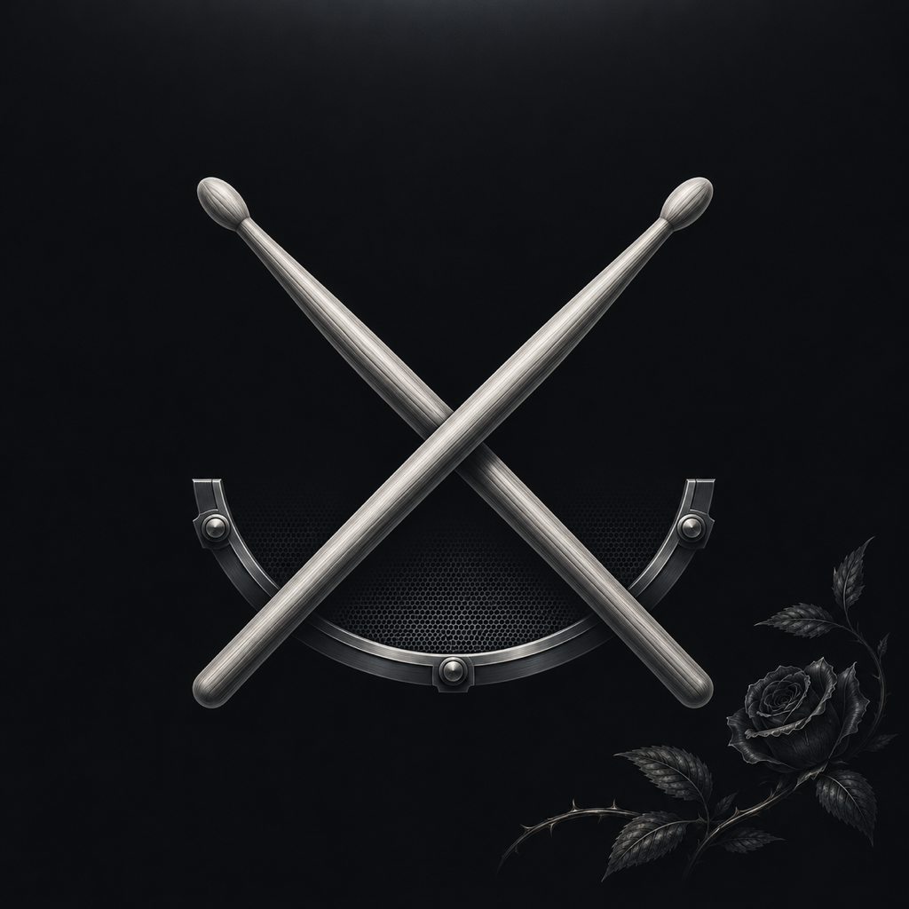

# Botanical Ink app icon

Crossed silver drumsticks and a partial snare rim on graphite, with a subtle botanical engraving. The icon follows the
owner-selected JakeLauncher Botanical Ink palette: obsidian `#101214`, graphite
`#1C2023`, porcelain `#EEEAE3` and silver `#A9B9C0`.



`native/StrikeCompanioniOS/Assets.xcassets/AppIcon.appiconset` contains opaque PNGs for
iPhone, iPad and the 1024-pixel marketing image. The application target selects
`AppIcon` through `ASSETCATALOG_COMPILER_APPICON_NAME`.

The raster artwork was generated with the built-in image tool on November 6, 2026,
using [JakeLauncher's botanical artwork](https://github.com/Coober666/JakeLauncher/blob/main/design/imagery/botanical-ink.jpg)
as a style reference. Smaller exports use macOS `sips` resampling. iOS supplies
the corner mask. The exported 1024-pixel PNG SHA-256 is `6cf198c6db35936a2c718ed91469967e02b1287e8ae8fe58dcb366f7467a6dc2`.

This is the artwork installed and read back from the owner's iPhone on November 6.
That installation retained the existing app version and identity; this repository
change brings the assets forward to current main. It changes no application logic
or saved-data format. Signing profiles and device identifiers are not included.

## Generation prompt

```text
Use case: logo-brand
Asset type: one production iOS app icon, square, full bleed opaque background.
Primary request: Design a premium personal app icon matching the user's actual JakeLauncher "Botanical Ink" design system.
Input images: Image 1 is a STYLE REFERENCE ONLY: the user's JakeLauncher dark botanical wallpaper. Create a NEW app icon; do not reproduce the wallpaper as the main subject.
Visual system: obsidian #101214 background, smoked graphite #1C2023 and #2B3034, porcelain #EEEAE3, cool silver #A9B9C0. Subtle silver upper-edge reflection and restrained dark elevation. Monochrome, sophisticated, quiet, slightly gothic, precise. Restrained botanical ink engraving confined to a small dim corner detail, the main glyph is bold and legible. No colored accents.
Composition: A single centered emblem around 62 percent of square width, ample negative space. Clean scalable contours with limited broad highlights. Flat frontal view, tactile engraved or satin metal inlay, not a photorealistic object. Background edge to edge; no enclosing rounded-square tile, no border frame, no perspective.
Constraints: no text, lettering, numbers, logos, watermarks, phone, mockup, grid, luminous effects, neon, plastic, toy clay, puffy materials, or rainbow gradients. Source square corners; OS supplies corner mask. Ensure recognizable at 60px. All four outer corners remain dark.
Subject: Two elegant, unmistakable silver DRUMSTICKS crossing in a bold X. Each has a short rounded olive tip and a long slender tapering shaft. An understated partial arc of an electronic snare rim behind their lower halves gives drum context without making a competing circle. The crossed-stick X is the dominant silhouette. Porcelain and satin silver highlights on graphite. One very subtle charcoal engraved rose-leaf sprig along lower right edge, barely visible, echoes the reference.
```
