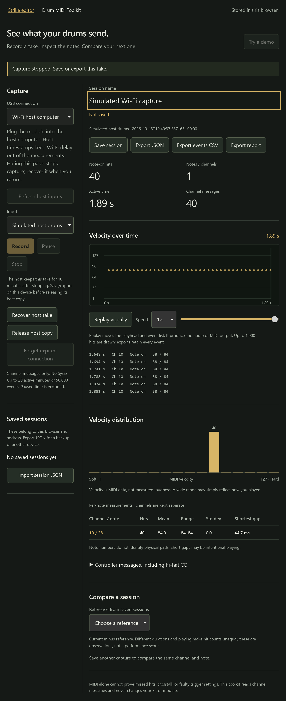

# Drum MIDI Toolkit

Open **Drum MIDI toolkit** on the editor's Start screen or in Tools. It opens a
separate page at `/midi`; no Strike kit needs to be loaded. **Try a demo** provides
a clearly marked synthetic groove without a connected device.


## Capture and keep a take

1. Run the editor on the computer with your USB MIDI device attached. Open its
   localhost address in a browser that supports Web MIDI.
2. Choose **Connect MIDI input**, grant access, then select your input explicitly.
3. Choose **Record**, play, and use **Pause / Resume** or **Stop** as needed.
   Disconnecting the input stops the capture and keeps the events already recorded.
4. Name the take and **Save session**. Sessions are stored in this browser's
   IndexedDB, separate from the Strike library and the active kit.
5. **Export JSON** for a portable backup. Import that JSON in the toolkit on another
   device. CSV exports the event stream; the text report exports measurements and
   the selected comparison. Standard `.mid` files are not supported in this version.

Saving is explicit. An unsaved take lives in page memory; leaving warns where the
browser permits it, but closing/crashing can lose it. Browser storage can be cleared,
evicted or unavailable in private browsing. A different browser, host address or port
has separate storage. Export JSON before changing any of those or clearing browser data.
If a save fails, the take remains in memory and export remains available.

## Live capture from iPad or iPhone over Wi-Fi

The module plugs into your **Mac, Windows PC or Linux host**. The mobile browser
controls the host input and receives the take; it does not need Web MIDI or direct USB.
Use the editor's existing Wi-Fi pairing link, then open **Drum MIDI toolkit**.



Install the optional input package **on the USB host**, using the same Python
environment that launches the editor:

```text
python -m pip install -r requirements-midi.txt
```

On a Mac/Linux installation whose command is `python3`, use `python3` instead.
The pinned package is python-rtmidi 1.5.8. Its published wheels cover Python 3.10–3.12
on common Windows, Intel/Apple Silicon Mac and Linux x86-64/ARM64 hosts; other Python
or platform combinations may require a native build. A Python 3.12 virtual environment
is the recommended starting point for this optional feature. For Linux builds, consult
the [driver's installation instructions](https://spotlightkid.github.io/python-rtmidi/installation.html).
This does not install or change anything on the module. Normal kit editing and
browser-local capture still work without this optional package.

1. Start the editor host with Wi-Fi enabled and pair the mobile browser as usual.
   Keep the host awake, use the same trusted LAN, and use the host's `http://` address.
2. The paired toolkit defaults to **Wi-Fi host computer**. Choose **Refresh host inputs**,
   explicitly choose the module/interface, then **Record**.
3. **Pause**, **Resume** and **Stop** control capture on the host. The chart updates
   in batches; event timing comes from the host, not Wi-Fi delivery speed.
4. **Save session** or **Export JSON** on the mobile device. **Release host copy** frees
   the temporary host take so another browser or a new take can use the input. It
   leaves the events already received in the page intact.

Only one host take is available at a time. Another paired browser cannot take over,
read it, pause it or delete it. Kit editing control is separate: a page may record
host MIDI while it is view-only for kit editing. No output is opened and no SysEx,
module settings, kit files or cards are written. Some MIDI drivers permit only one
application to own an input; close the competing MIDI input application if opening fails.

### Connection loss and recovery

- The host keeps up to 50,000 events / 20 active minutes in memory, sending numbered
  batches so a repeated fetch cannot duplicate events. The page labels an incomplete
  copy **Partial take**; JSON, CSV and reports preserve that status.
- **Recover host take** retrieves missing batches after a dropped response or reload
  of the same tab. The tab remembers its capture ID when browser session storage is
  available. Recovery never starts a new capture. If the existing take is still
  recording, recovery displays that state; choose Stop when done.
- Hiding/leaving the page requests Stop. If that request cannot arrive, 15 seconds
  without polling stops capture independently. It does not resume on return; use
  Recover to retrieve what the host retained. Keep the recording page visible.
- A stopped take expires after **10 minutes**, even if polled. Host restart/Stop,
  logout or pairing loss may make recovery impossible; host buffers are not durable
  backups. Export JSON to keep your take. A driver overflow/error leaves it partial.
- If the host has restarted or the take expired, **Forget expired connection** keeps
  the received events and lets you select a new input. Forget does not remotely delete
  an unreachable host's take. Re-pair first if the pairing session has expired.

Complete means this browser received the entire host take. It does not establish that
the driver received every physical hit. Captures/imports are observational data.

## What the measurements mean

- Counts include complete MIDI channel messages: notes, controllers, pressure,
  program changes and pitch bend. System messages, clock and SysEx are ignored.
- A hit is a Note On with velocity greater than zero. Note On with velocity zero is
  treated as Note Off. Channel and note are kept separate; no physical pad is guessed.
- Velocity histograms, mean, range and population standard deviation describe the
  observed MIDI values. They do not measure audio loudness or grade playing.
- The shortest repeated-note gap is observed timing, not a double-trigger diagnosis.
  MIDI alone cannot establish missed physical hits, crosstalk or a trigger-setting fault.
- Capture uses browser event timestamps when available, with a receipt-time fallback.
  Timing depends on the browser/interface; it is not a calibrated latency measurement.
  Paused time is excluded. Pause boundaries are retained in JSON/CSV, and repeated-note
  gap measurements never cross a recorded pause boundary.
- Compare pairs the same channel/note across two saved takes. Missing pairs stay
  missing; different durations and playing can explain different hit counts.
- **Replay visually** moves the playhead and event list. It neither sends MIDI nor
  plays audio. Capture never opens or accesses MIDI outputs or changes module settings.

## Devices and limits

The parser is module-independent. Generic channel MIDI and the host input driver are simulated in tests;
Strike, Command, Nitro and other physical modules still require capture acceptance.
Do not infer device compatibility from a synthetic test.

Live capture requires a supporting browser and secure context (localhost is the
normal computer-host workflow); see [Web MIDI access requirements](https://developer.mozilla.org/en-US/docs/Web/API/Navigator/requestMIDIAccess).
The UI detects availability for direct browser capture. Paired LAN HTTP pages instead
offer input capture on the host, including from iPad/iPhone browsers without Web MIDI.
Native apps/direct mobile USB remain separate work. Wi-Fi toolkit assets and capture
requests require the editor's existing pairing. Analysis/capture does not acquire
editing control of the shared Strike kit.

Each session is limited to 20 active minutes and 50,000 events. Capture stops at
either limit and retains the take. Import rejects invalid versions/messages,
out-of-order timestamps and files over 8 MB instead of silently changing them.
The browser holds up to 25 saved sessions; export/delete an older session if full.
The timeline samples at most 1,000 hits and tables show at most 128 groups; exports
contain the full received data, with partial status where applicable. Imported sessions
stay in the browser; host-captured events travel from the paired host to that browser.
No session is uploaded to an external service.

## Verification

`npm run test:midi` checks deterministic parsing, statistics, channel separation,
zero-velocity notes, validation, CSV quoting/formula protection and comparisons.
`tests/browser/midi-toolkit.spec.js` runs in Chromium and simulated iPad WebKit:
capture/pause/disconnect, limits, persistence, comparison/export/replay, invalid import,
storage failure, permission denial, narrow layout and paired Wi-Fi analysis.
WebKit capture tests inject a fake MIDI input; they do not establish native iPad support.
`tools/test_midi_capture.py` tests host timing, pause boundaries, ownership, idempotency,
limits, lease expiry and an injected input-only RtMidi boundary. `wifi-midi.spec.js`
uses the real paired server with a simulated host input in Chromium and iPad WebKit,
covering capture/export, lost responses, hidden pages and reload recovery. This does
not verify a physical Strike/Command/Nitro, OS MIDI driver or mobile device.
