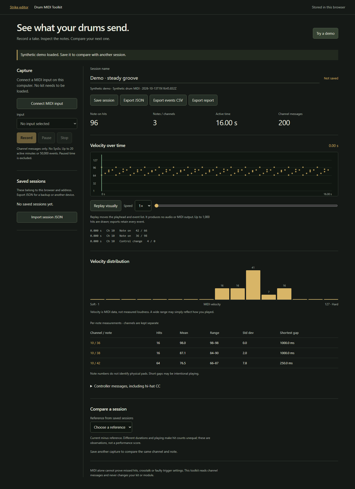

# Drum MIDI Toolkit

Open **Drum MIDI toolkit** on the editor's Start screen or in Tools. It opens a
separate page at `/midi`; no Strike kit needs to be loaded. **Try a demo** provides
a clearly marked synthetic groove without a connected device.

## Capture and keep a take

1. Run the editor on the computer with your USB MIDI device attached. Open its
   localhost address in a browser that supports Web MIDI.
2. Choose **Connect MIDI input**, grant access, then select your input explicitly.
3. Choose **Record**, play, and use **Pause / Resume** or **Stop** as needed.
   Disconnecting the input stops the capture and keeps the events already recorded.
4. Name the take and **Save session**. Sessions are stored in this browser's
   IndexedDB, separate from the Strike library and the active kit.
5. **Export JSON** for a portable backup. Import that JSON in the toolkit on another
   device. CSV exports the event stream; the text report exports measurements and
   the selected comparison. Standard `.mid` files are not supported in this version.

Saving is explicit. An unsaved take lives in page memory; leaving warns where the
browser permits it, but closing/crashing can lose it. Browser storage can be cleared,
evicted or unavailable in private browsing. A different browser, host address or port
has separate storage. Export JSON before changing any of those or clearing browser data.
If a save fails, the take remains in memory and export remains available.

## What the measurements mean

- Counts include complete MIDI channel messages: notes, controllers, pressure,
  program changes and pitch bend. System messages, clock and SysEx are ignored.
- A hit is a Note On with velocity greater than zero. Note On with velocity zero is
  treated as Note Off. Channel and note are kept separate; no physical pad is guessed.
- Velocity histograms, mean, range and population standard deviation describe the
  observed MIDI values. They do not measure audio loudness or grade playing.
- The shortest repeated-note gap is observed timing, not a double-trigger diagnosis.
  MIDI alone cannot establish missed physical hits, crosstalk or a trigger-setting fault.
- Capture uses browser event timestamps when available, with a receipt-time fallback.
  Timing depends on the browser/interface; it is not a calibrated latency measurement.
  Paused time is excluded. Pause boundaries are retained in JSON/CSV, and repeated-note
  gap measurements never cross a recorded pause boundary.
- Compare pairs the same channel/note across two saved takes. Missing pairs stay
  missing; different durations and playing can explain different hit counts.
- **Replay visually** moves the playhead and event list. It neither sends MIDI nor
  plays audio. Capture never opens or accesses MIDI outputs or changes module settings.

## Devices and limits

The parser is module-independent. Generic channel MIDI is simulated in tests;
Strike, Command, Nitro and other physical modules still require capture acceptance.
Do not infer device compatibility from a synthetic test.

Live capture requires a supporting browser and secure context (localhost is the
normal computer-host workflow); see [Web MIDI access requirements](https://developer.mozilla.org/en-US/docs/Web/API/Navigator/requestMIDIAccess).
The UI detects availability. An iPad/iPhone or a LAN HTTP page can import and analyse
session JSON even when live MIDI is unavailable. This page does **not** forward the
computer's MIDI inputs over Wi-Fi. Native apps/direct mobile USB and live host streaming
remain separate work. Wi-Fi toolkit assets require the editor's existing pairing;
local analysis does not acquire editing control of the shared Strike kit.

Each session is limited to 20 active minutes and 50,000 events. Capture stops at
either limit and retains the take. Import rejects invalid versions/messages,
out-of-order timestamps and files over 8 MB instead of silently changing them.
The browser holds up to 25 saved sessions; export/delete an older session if full.
The timeline samples at most 1,000 hits and tables show at most 128 groups; exports
contain the full data. No session is uploaded to the editor host or an external service.

## Verification

`npm run test:midi` checks deterministic parsing, statistics, channel separation,
zero-velocity notes, validation, CSV quoting/formula protection and comparisons.
`tests/browser/midi-toolkit.spec.js` runs in Chromium and simulated iPad WebKit:
capture/pause/disconnect, limits, persistence, comparison/export/replay, invalid import,
storage failure, permission denial, narrow layout and paired Wi-Fi analysis.
WebKit capture tests inject a fake MIDI input; they do not establish native iPad support.
